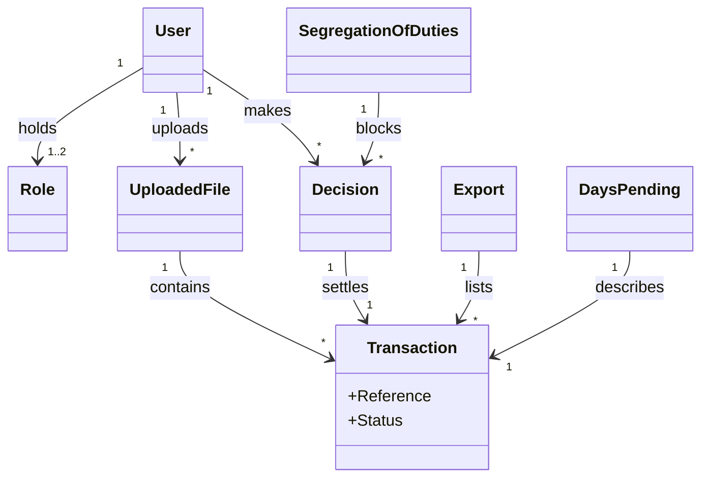

# Requirements: Transaction Management Frontend

**Domain:** Transaction Management **Target:** application **Created:** 2026-11-11 **Status:** final **Last finalised at:** 2026-11-11T13:50:20Z

## Export provenance

| Field | Value |
| --- | --- |
| Source document | `generated-docs/requirements/requirements-prototype.md` |
| Source sha256 | 2c5e14f92850ddc6a22e3eb54ce7ad11cd4ae12da9967a0e7ed8c525e8c5c14d |
| Source status / last finalised at | final / 2026-11-11T13:50:20Z |
| Exported at | 2026-11-12T06:46:21Z |
| Produced by | `/export-requirements` — re-projection of the prototype-target document to the application audience. The re-projection improvises nothing: every net-new byte it adds is either mechanical (paths, hash, timestamp) or a fixed literal. Before re-projection, the source's consultant-approved amendments were folded into the body; folded wording comes from those amendments, reshaped to fit its row or bullet — see `Amendments folded`. |
| Input recovery | none — this export adds no facts beyond the source document and its consultant-approved amendments. Cells tagged `[SRC: C-NNN]` are input-grounded and grounding-verified. Cells tagged `[SRC: <filename>]` carry folded amendment content. Untagged cells were consultant-resolved, filled deterministically from framework standard rules, or domain-defaulted, and carry no input citation. |
| Amendments folded | 7 amendment(s) from 1 amendment document(s) (amendments-2026-11-12.md) folded into the body before re-projection (folded 7; quote-mismatch-folded 0; absorbed-by-chain 0; collision-loser 0; spread edits 4). Requirement IDs minted by the fold: UI-21, UI-22, UI-23, UI-24. Minted IDs are export-local and absent from the source document. |
| Known residue | none — no prototype-mode framing survived the projection. |
| Gate outcome | accepted |
| Citation legend | `[SRC: C-NNN]` = input-grounded claim; resolves against `generated-docs/requirements/draft-claims.ndjson` (verbatim source quotes) — include that file in any handoff bundle. `Supports/Enables/Enforces/Serves → §…` in §6.1 Rationale = derived cross-reference into the named section of this document. `[SRC: <filename>]` = content folded from a consultant-approved amendment recorded in the named `documentation/` file, or a line edited to agree with one. It is consultant-approved, but it did not pass input-grounding verification and does not resolve against `draft-claims.ndjson`. |
| Backend contract pointers | §6.10 uses the placeholder base `../backend/requirements.md` until a backend requirements document exists — rebind the base path on handoff. One pointer per operation; this document never restates the contract. |

## In plain terms

- **What we found:** The inputs describe a transaction-approval frontend where File Importers upload seven-column .csv files, Approvers approve or reject transactions singly or in bulk, and both roles export actioned transactions. A user who holds both roles cannot decide transactions from a file that user uploaded, and a bulk action that includes one is refused whole. Account numbers are shown in full with no masking, and files arrive many times per hour.
- **What it means for you:** Decisions are final, and correction, transaction editing and downstream posting are out of scope.

---

## Contents

- [1. Application context](#1-application-context)
- [1.5 Scope](#15-scope)
- [1.6 Assumptions & dependencies](#16-assumptions-dependencies)
- [1.7 Architectural implications](#17-architectural-implications)
- [1.8 Application character](#18-application-character)
- [2. Domain model](#2-domain-model)
  - [2.1 Concepts](#21-concepts)
  - [2.2 Relationships](#22-relationships)
  - [2.3 Aggregates & lifecycles](#23-aggregates-lifecycles)
    - [Transaction](#transaction)
    - [Uploaded file](#uploaded-file)
    - [Access](#access)
  - [2.4 Diagram (optional)](#24-diagram-optional)
  - [2.5 State-transition matrix](#25-state-transition-matrix)
    - [Transaction](#transaction-1)
- [3. Target users](#3-target-users)
  - [File Importer](#file-importer)
  - [Approver](#approver)
- [4. User goals & stories](#4-user-goals-stories)
  - [4.1 Goals catalogue](#41-goals-catalogue)
  - [4.2 Stories by persona](#42-stories-by-persona)
    - [File Importer <!-- → §3 -->](#file-importer----3---)
    - [Approver](#approver-1)
- [5. Task flows](#5-task-flows)
  - [Flow: Log in](#flow-log-in)
  - [Flow: Upload transaction file](#flow-upload-transaction-file)
  - [Flow: View and download uploaded files](#flow-view-and-download-uploaded-files)
  - [Flow: Review transactions](#flow-review-transactions)
  - [Flow: Decide transactions](#flow-decide-transactions)
  - [Flow: Export actioned transactions](#flow-export-actioned-transactions)
- [6. Requirements](#6-requirements)
  - [6.1 Functional](#61-functional)
  - [6.2 Business rules](#62-business-rules)
  - [6.3 Validation rules](#63-validation-rules)
  - [6.4 UI feature needs](#64-ui-feature-needs)
    - [6.4.5 Edge, empty & error states](#645-edge-empty-error-states)
  - [6.5 Access control (RBAC)](#65-access-control-rbac)
  - [6.6 Non-functional (FE-only)](#66-non-functional-fe-only)
    - [6.6.1 Session UX](#661-session-ux)
    - [6.6.2 Frontend performance budgets](#662-frontend-performance-budgets)
    - [6.6.4 Compliance UI behaviour](#664-compliance-ui-behaviour)
    - [6.6.5 Accessibility](#665-accessibility)
  - [6.7 Reporting feature needs](#67-reporting-feature-needs)
  - [6.8 Notification points](#68-notification-points)
  - [6.10 Consumed backend contracts](#610-consumed-backend-contracts)
    - [Under `target = application`](#under-target-application)
- [7. Data shapes consumed by the FE](#7-data-shapes-consumed-by-the-fe)
  - [Shape: Transaction](#shape-transaction)
  - [Shape: Uploaded file](#shape-uploaded-file)
  - [Shape: Decision](#shape-decision)
  - [Shape: User](#shape-user)
  - [Shape: Login request](#shape-login-request)
  - [7.X Derivations](#7x-derivations)
- [9. Key terminology](#9-key-terminology)
- [10. Volumes](#10-volumes)
- [For downstream use](#for-downstream-use)

---
## 1. Application context

**Name:** Transaction Management Frontend [SRC: C-001]

**Purpose / business value:** Users with the File Importer role upload transaction files, and users with the Approver role approve or reject the imported transactions. Both roles view files and export actioned transactions. [SRC: C-002]

**Domain:** Transaction Management [SRC: C-003]

**Business goal:** Every imported transaction receives a final approval or rejection, so that actioned transactions can be exported. [SRC: C-004]

<!-- rev: run-1 2026-11-11 -->

---

## 1.5 Scope

| Bucket | Items |
| --- | --- |
| In | Sign-in and sign-out; .csv file upload; file listing and download; transaction viewing with filtering and sorting; individual and bulk approval and rejection with a rejection reason; role-based access with a segregation-of-duties block; export of selected actioned transactions and quick export to .csv [SRC: C-005] |
| Out | Correction or reversal of a decision; editing of transaction data; downstream posting or release after a decision; missing-file alerts [SRC: C-006] |
| Deferred | None; no screen is deferred to a later phase [SRC: C-007] |

<!-- rev: run-1 2026-11-11 -->

---

## 1.6 Assumptions & dependencies

> Abstract services, persona prerequisites, environment assumptions. Cells name capability categories, never a product or vendor. Omitted entirely when nothing applies (§0.1 content-conditional).

| Kind | Statement | Source |
| --- | --- | --- |
| Abstract service dependency | An authentication service validates credentials, starts a session held in a session cookie, and returns the signed-in user with the user's roles [SRC: C-008] | stated |
| Abstract service dependency | A transaction service lists transactions with their status and records each approval and rejection [SRC: C-009] | stated |
| Persona prerequisite | Each user holds the File Importer role, the Approver role, or both, assigned in the backend [SRC: C-010] | stated |
| Environment assumption | The frontend and the authentication service share a registrable domain, so the session cookie reaches both [SRC: C-011] | stated |
| Environment assumption | Transaction .csv files arrive ad hoc with no fixed schedule, and the producing source system stays unnamed [SRC: C-012] | stated |

<!-- rev: run-1 2026-11-11 -->

---

## 1.7 Architectural implications

> **Application-build guidance.** Capability categories derived by the drafter from §6 functional requirements + §10 volumes + §6.7 reporting needs, against an inline catalogue of ≤15 categories (see `framework/agents/requirements-drafter.md > derive-architectural-implications`). Drafter seeds every row as a non-blocking suggestion; resolver Q&A refines. Recommendation column is **optional** and **non-deterministic** — a stack choice belongs in the code-generation step, not here.

| Capability category | Driving requirement(s) | Recommendation (optional) |
| --- | --- | --- |
| Client-side state management | → §6.1 F-14 "A user can select transactions" / → §6.1 F-09 "A user can filter transactions by date, account number" | |
| Client-side search / filtering | → §6.1 F-09 "A user can filter transactions by date, account number" / → §6.1 F-18 "A user can filter actioned transactions by approval" / → §10 "Data volume" | in-memory index acceptable |
| Export rendering capability | → §6.1 F-20 "A user can export selected actioned transactions" / → §6.7 RPT-01 "Export of selected actioned transactions" | |
| File upload / binary blob handling | → §6.1 F-04 "A File Importer can upload a .csv file" / → §6.1 F-07 "A user can download an uploaded file" | binary blob storage tier required |
| Role-conditional rendering | → §6.2 BR-03 "When a user who holds both roles" / → §6.2 BR-04 "When a user does not hold the" | |
| Notification delivery surface | → §6.8 NT-01 "A file is rejected at upload" / → §6.8 NT-02 "A decision is recorded" | in-app channel only |

<!-- rev: run-1 2026-11-11 -->

---

## 1.8 Application character

> The persona/voice of the application's **own user-facing copy** — notifications, error messages, validation messages, confirmations, empty states. Governs tone and phrasing only; what feedback exists, when it appears, and how it is structured remain governed by the standard feedback rules and the design pipelines. This is the application's voice toward its end users — not an agent character, and not a §3 persona.

**Selected character:** Calm compliance assistant — states each outcome plainly and treats every decision as final and traceable.

**Tone attributes:** precise, calm, neutral, direct, respectful of the user's expertise

| Copy surface | Guidance | Example |
| --- | --- | --- |
| Notifications | State what happened and to which item; add nothing else. | "Transaction TXN-20260415-0001 was approved." |
| Errors | Say what failed and what the user can do next; never blame the user. | "The file could not be uploaded. Check the file and try again." |
| Validation | Name the missing or wrong input in one short sentence. | "Enter a rejection reason to continue." |
| Confirmations | Name the affected items and state that the decision is final. | "Reject 3 selected transactions? This decision is final." |
| Empty states | Name what is missing and the next step the user's role allows. | "No files have been uploaded yet." |

<!-- rev: run-1 2026-11-11 -->

---

## 2. Domain model

> The BA's framing of the business domain in **ubiquitous language**, implementation-free.

### 2.1 Concepts

| Concept | Persistence | Definition (ubiquitous language) |
| --- | --- | --- |
| Transaction | persistent | A single financial entry read in from an uploaded file, carrying a reference, date, account number, description, amount, type and currency, and holding a status of Pending, Approved or Rejected. [SRC: C-013] |
| Uploaded file | persistent | A .csv document of transactions that a File Importer has uploaded, kept so that users can see its name and upload timestamp and download it. [SRC: C-014] |
| Decision | persistent | The recording of an approval or a rejection against one transaction, with a rejection reason when the transaction is rejected. [SRC: C-015] |
| User | persistent | A person who signs in with a username and password and holds one or both roles. [SRC: C-016] |
| Role | policy | A named set of permitted actions held by a user in the backend, either File Importer or Approver. [SRC: C-017] |
| Segregation of duties | policy | The control that stops a user from approving or rejecting transactions from a file that the same user uploaded, including inside bulk actions. [SRC: C-018] |
| Export | derived | A .csv file of the user's selected actioned transactions, in the import layout plus a Status field, downloaded to the user's local machine. [SRC: C-019] |
| Days pending | derived | The number of days that a pending transaction has been pending. [SRC: C-020] |

### 2.2 Relationships

- User **holds** Role [1..2]
- User **uploads** Uploaded file [0..*]
- Uploaded file **contains** Transaction [1..*]
- User **makes** Decision [0..*]
- Decision **settles** Transaction [1..1]
- Segregation of duties **blocks** Decision [0..*]
- Export **lists** Transaction [1..*]
- Days pending **describes** Transaction [0..1]

### 2.3 Aggregates & lifecycles

#### Transaction

| Field | Value |
| --- | --- |
| Member concepts | Transaction, Decision, Days pending |
| Lifecycle states | Pending → Approved, or Pending → Rejected |
| Key invariants | A decision is final and no status changes after it. Transaction data is read-only. A rejection carries a recorded reason. A user cannot decide transactions from a file the same user uploaded. Only actioned transactions can be exported. A decision triggers no downstream action. |

#### Uploaded file

| Field | Value |
| --- | --- |
| Member concepts | Uploaded file |
| Lifecycle states | Uploaded successfully |
| Key invariants | Only the seven-column .csv layout is accepted. The uploader of each file is recorded. |

#### Access

| Field | Value |
| --- | --- |
| Member concepts | User, Role, Segregation of duties |
| Lifecycle states | None in this application; roles are set up in the backend |
| Key invariants | Only a File Importer uploads files. Only an Approver approves or rejects transactions. |

### 2.4 Diagram (optional)

### 2.5 State-transition matrix

> Emitted only when ≥1 §2.3 aggregate has more than two lifecycle states. One sub-block per qualifying aggregate. Pre-condition cells may reference `→ §6.2 BR-NN`.

#### Transaction

| From → To | Trigger | Pre-condition | Visible effect |
| --- | --- | --- | --- |
| Pending → Approved | An Approver approves the transaction [SRC: C-021] | The transaction is Pending and the Approver did not upload its file [SRC: C-022] | The status reads Approved, and approve and reject actions are hidden with a notice naming the state. |
| Pending → Rejected | An Approver rejects the transaction and gives a reason [SRC: C-023] | The transaction is Pending and the Approver did not upload its file [SRC: C-024] | The status reads Rejected with its reason, and approve and reject actions are hidden with a notice naming the state. |

<!-- rev: run-1 2026-11-11 -->

---

## 3. Target users

> Target-user personas — the end users of the application being designed. Not to be confused with the Unicorn (LLM) or the Consultant (audience).

### File Importer

| Field | Value |
| --- | --- |
| Role / job title | File Importer [SRC: C-025] |
| Expertise level | Operations user who handles .csv files |
| Stakes | Wrongly laid-out files stall the review of transactions |
| Frequency of use | Uploads a file whenever one is received [SRC: C-026] |
| Driving forces — wants | Upload .csv files and see them listed [SRC: C-027] |
| Driving forces — fears | Uploading a file that the application then rejects |

### Approver

| Field | Value |
| --- | --- |
| Role / job title | Approver [SRC: C-028] |
| Expertise level | Finance or operations reviewer who judges transactions |
| Stakes | Each decision is final and cannot be corrected in the application |
| Frequency of use | Continuously during working hours |
| Driving forces — wants | Approve or reject transactions, individually or in bulk [SRC: C-029] |
| Driving forces — fears | Deciding the wrong transaction with no way to undo it |

<!-- rev: run-1 2026-11-11 -->

---

## 4. User goals & stories

> Quality signals live on the goal (outcome-level), not the story (behaviour-level).

### 4.1 Goals catalogue

| ID | Goal statement | Quality signals | Goal kind | Layout pref (optional) | UX-pattern pref (optional) |
| --- | --- | --- | --- | --- | --- |
| G-01 | Every imported transaction is approved or rejected by an authorised reviewer. [SRC: C-030] | No pending transaction remains once review is complete | top-level | None stated | None stated |
| G-02 | Actioned transactions can be exported to a .csv file. [SRC: C-031] | An export contains only approved or rejected transactions | top-level | None stated | None stated |
| G-03 | Received transaction data enters the application only as a correctly laid-out .csv file. [SRC: C-032] | Any other layout or file type is rejected at upload with a clear message | sub-level | None stated | None stated |
| G-04 | Uploaded files can be seen and downloaded. [SRC: C-033] | Each uploaded file shows its name and upload timestamp | sub-level | None stated | None stated |
| G-05 | Transactions can be found by filtering and sorting. [SRC: C-034] | Filters cover five dimensions and sorts cover every column shown in the table [SRC: amendments-2026-11-12.md] | sub-level | None stated | None stated |
| G-06 | Every rejection carries a recorded reason. [SRC: C-035] | No rejected transaction lacks a reason | sub-level | None stated | None stated |
| G-07 | Decisions are final and transaction data stays read-only. [SRC: C-036] | No status changes after a decision and no field can be edited | sub-level | None stated | None stated |
| G-08 | Each action is limited to the role entitled to it. [SRC: C-037] | Only File Importers upload and only Approvers decide | sub-level | None stated | None stated |
| G-09 | Users sign in with their own credentials. [SRC: C-038] | Every screen requires a valid session | sub-level | None stated | None stated |
| G-10 | Many transactions can be decided in one action. [SRC: C-039] | One action covers every selected transaction | interaction-level | None stated | None stated |
| G-11 | A day, week or month of actioned transactions can be exported quickly. [SRC: C-040] | A quick export needs only a period and a decision choice | interaction-level | None stated | None stated |
| G-12 | The age of each pending transaction is visible. [SRC: C-041] | Each pending transaction shows its days pending | sub-level | None stated | None stated |

### 4.2 Stories by persona

#### File Importer <!-- → §3 -->

##### Story: As a File Importer, I want to upload a .csv file, so that the received transactions are read in

| Field | Value |
| --- | --- |
| Goal | → §4.1 G-03 "Received transaction data enters the application only" |
| Priority | Must |
| Objective | Upload a .csv file and learn at once whether it was accepted. [SRC: C-042] |
| Context (frequency / expertise / stakes) | Whenever a file is received; operations user; a rejected file delays review |
| Linked task flow (optional) | → §5 Flow: Upload transaction file |
| Acceptance criteria | Given a .csv file in the required layout, when the File Importer uploads it, then the file appears in the file list and its transactions appear in the transaction list. [SRC: C-043] |

##### Story: As a File Importer, I want to view and download uploaded files, so that I can inspect what has been brought in

| Field | Value |
| --- | --- |
| Goal | → §4.1 G-04 "Uploaded files can be seen and downloaded" |
| Priority | Should |
| Objective | See each uploaded file with its name and upload timestamp, and download it. [SRC: C-044] |
| Context (frequency / expertise / stakes) | After uploads; operations user; low stakes |
| Linked task flow (optional) | → §5 Flow: View and download uploaded files |
| Acceptance criteria | Given a successfully uploaded file, when the File Importer opens the file list, then the file name and upload timestamp are shown and the file can be downloaded. [SRC: C-045] |

##### Story: As a File Importer, I want to view the uploaded transactions without changing them, so that I can see what was read in

| Field | Value |
| --- | --- |
| Goal | → §4.1 G-05 "Transactions can be found by filtering" |
| Priority | Should |
| Objective | View the transactions that have been read in, with no way to edit or decide them. [SRC: C-046] |
| Context (frequency / expertise / stakes) | After uploads; operations user; low stakes |
| Linked task flow (optional) | → §5 Flow: Review transactions |
| Acceptance criteria | Given transactions that were read in, when the File Importer opens the transaction view, then the transactions are listed and no approve, reject or edit action is offered. [SRC: C-047] |

##### Story: As a File Importer, I want to export actioned transactions, so that decisions can be taken out of the application

| Field | Value |
| --- | --- |
| Goal | → §4.1 G-02 "Actioned transactions can be exported" |
| Priority | Must |
| Objective | Export actioned transactions to a .csv file on the local machine. [SRC: C-048] |
| Context (frequency / expertise / stakes) | After decisions are made; operations user; moderate stakes |
| Linked task flow (optional) | → §5 Flow: Export actioned transactions |
| Acceptance criteria | Given approved and rejected transactions, when the File Importer exports a selection, then a .csv file is downloaded and pending transactions are not offered for export. [SRC: C-049] |

##### Story: As a File Importer, I want to sign in with my own credentials, so that I reach only what my role allows

| Field | Value |
| --- | --- |
| Goal | → §4.1 G-09 "Users sign in with their own credentials" |
| Priority | Must |
| Objective | Sign in with a username and password. [SRC: C-050] |
| Context (frequency / expertise / stakes) | At the start of each session; operations user; access to financial data |
| Linked task flow (optional) | → §5 Flow: Log in |
| Acceptance criteria | Given valid credentials, when the File Importer signs in, then the application opens with the actions that the File Importer role allows. [SRC: C-051] |

#### Approver

##### Story: As an Approver, I want to filter and sort the transactions, so that I can find the ones I need to decide

| Field | Value |
| --- | --- |
| Goal | → §4.1 G-05 "Transactions can be found by filtering" |
| Priority | Should |
| Objective | Filter by date, account number, amount, transaction type and currency, and sort by any column shown in the table. [SRC: amendments-2026-11-12.md] |
| Context (frequency / expertise / stakes) | Continuously during working hours; finance or operations reviewer; moderate stakes |
| Linked task flow (optional) | → §5 Flow: Review transactions |
| Acceptance criteria | Given a list of transactions, when the Approver applies filters and a sort, then only matching transactions are shown in the chosen order. [SRC: C-053] |

##### Story: As an Approver, I want to approve or reject a transaction individually, so that it is actioned

| Field | Value |
| --- | --- |
| Goal | → §4.1 G-01 "Every imported transaction is approved or rejected" |
| Priority | Must |
| Objective | Approve a transaction, or reject it with a text reason. [SRC: C-054] |
| Context (frequency / expertise / stakes) | Continuously during working hours; finance or operations reviewer; each decision is final |
| Linked task flow (optional) | → §5 Flow: Decide transactions |
| Acceptance criteria | Given a pending transaction, when the Approver approves it or rejects it with a reason, then its status changes and no further change is possible. [SRC: C-055] |

##### Story: As an Approver, I want to approve or reject several selected transactions in one action, so that large batches are actioned quickly

| Field | Value |
| --- | --- |
| Goal | → §4.1 G-10 "Many transactions can be decided in one" |
| Priority | Should |
| Objective | Select transactions and approve them together, or reject them together with one shared reason. [SRC: C-056] |
| Context (frequency / expertise / stakes) | Continuously during working hours; finance or operations reviewer; a wrong selection cannot be undone in the application |
| Linked task flow (optional) | → §5 Flow: Decide transactions |
| Acceptance criteria | Given several selected transactions, when the Approver rejects them with one reason, then every selected transaction is Rejected with that reason. [SRC: C-057] |

##### Story: As an Approver, I want to see how many days each pending transaction has been pending, so that the age of undecided transactions is visible

| Field | Value |
| --- | --- |
| Goal | → §4.1 G-12 "The age of each pending transaction" |
| Priority | Should |
| Objective | See the days pending on each pending transaction. [SRC: C-058] |
| Context (frequency / expertise / stakes) | Continuously during working hours; finance or operations reviewer; no deadline applies |
| Linked task flow (optional) | → §5 Flow: Review transactions |
| Acceptance criteria | Given a pending transaction, when the Approver views the transaction list, then the number of days it has been pending is shown. [SRC: C-059] |

##### Story: As an Approver, I want to export selected actioned transactions, so that decisions can be taken out of the application

| Field | Value |
| --- | --- |
| Goal | → §4.1 G-02 "Actioned transactions can be exported" |
| Priority | Must |
| Objective | Select actioned transactions and export them to a .csv file. [SRC: C-060] |
| Context (frequency / expertise / stakes) | After decisions are made; finance or operations reviewer; moderate stakes |
| Linked task flow (optional) | → §5 Flow: Export actioned transactions |
| Acceptance criteria | Given selected approved or rejected transactions, when the Approver exports them, then a .csv file in the import layout plus a Status field is downloaded. [SRC: C-061] |

##### Story: As an Approver, I want a quick export for the day, week or month, so that recurring period exports need no manual selection

| Field | Value |
| --- | --- |
| Goal | → §4.1 G-11 "A day, week or month of actioned" |
| Priority | Should |
| Objective | Export a day's, week's or month's transactions after choosing approved, rejected or both. [SRC: C-062] |
| Context (frequency / expertise / stakes) | Recurring; finance or operations reviewer; moderate stakes |
| Linked task flow (optional) | → §5 Flow: Export actioned transactions |
| Acceptance criteria | Given a chosen period and a decision choice, when the Approver starts a quick export, then a .csv file of the matching transactions is downloaded. [SRC: C-063] |

---

## 5. Task flows

### Flow: Log in

| Field | Value |
| --- | --- |
| Actor | File Importer, Approver [SRC: C-064] |
| Trigger | A user opens the application without a valid session [SRC: C-065] |
| Steps | 1. (User enters a username and password; both entries are shown as entered) 2. (User submits; the application starts a session) 3. (The application opens with the actions that the user's roles allow) [SRC: C-066] |
| Decision points | Credentials are valid or invalid [SRC: C-067] |
| Exception paths | {credentials invalid → a generic message that does not reveal which field was incorrect → the user re-enters the credentials}; {username or password missing → "Username and password are required." → the user completes both entries} [SRC: C-068] |
| Role-conditional behaviour | The actions offered after sign-in depend on the user's roles |

### Flow: Upload transaction file

| Field | Value |
| --- | --- |
| Actor | File Importer [SRC: C-069] |
| Trigger | A user with the File Importer role receives a transaction file [SRC: C-070] |
| Steps | 1. (User chooses a .csv file; the file name is shown) 2. (User submits the upload; the application checks the layout) 3. (The file is accepted; it appears in the file list) [SRC: C-071] |
| Decision points | The file is in the seven-column layout or not [SRC: C-072] |
| Exception paths | {file in another layout or of another type → a clear message states that only the required layout is accepted → the user uploads a conforming file} [SRC: C-073] |
| Role-conditional behaviour | Only a File Importer sees the upload action |

### Flow: View and download uploaded files

| Field | Value |
| --- | --- |
| Actor | File Importer, Approver [SRC: C-074] |
| Trigger | A user opens the file list [SRC: C-075] |
| Steps | 1. (User opens the file list; each file shows its name and upload timestamp) 2. (User chooses to download a file; the file is saved to the local machine) [SRC: C-076] |
| Decision points | None; the flow has a single path |
| Exception paths | {server error on download → the error message from the server is shown → the user retries the download} [SRC: C-077] |
| Role-conditional behaviour | Both roles see the same file list and download action |

### Flow: Review transactions

| Field | Value |
| --- | --- |
| Actor | File Importer, Approver [SRC: C-078] |
| Trigger | A user opens the transaction view [SRC: C-079] |
| Steps | 1. (User opens the transaction view; the transactions read in are listed) 2. (User applies filters; only matching transactions are listed) 3. (User chooses a sort; the list is reordered) 4. (An Approver selects transactions; the selected transactions are marked) [SRC: amendments-2026-11-12.md] |
| Decision points | Which of the five filters to use and which column to sort by [SRC: amendments-2026-11-12.md] |
| Exception paths | {no transaction matches the filters → the active filters stay visible with a clear-all action → the user clears the filters} |
| Role-conditional behaviour | Only an Approver is offered the approve and reject actions |

### Flow: Decide transactions

| Field | Value |
| --- | --- |
| Actor | Approver [SRC: C-082] |
| Trigger | An Approver chooses to approve or reject one transaction or several selected transactions [SRC: C-083] |
| Steps | 1. (Approver selects one or more transactions; the selection is marked) 2. (Approver chooses approve or reject; a confirmation step names the affected transactions) 3. (For a rejection the Approver enters one text reason; the reason is accepted) 4. (Approver confirms; the status of each transaction changes to Approved or Rejected) [SRC: C-084] |
| Decision points | Individual or bulk, and approve or reject [SRC: C-085] |
| Exception paths | {transaction belongs to a file the same user uploaded → the action is blocked with a message naming the reason → another user with the Approver role decides}; {rejection reason left empty → the prompt stays open → the Approver enters a reason} [SRC: C-086] |
| Role-conditional behaviour | Only an Approver sees the decide actions, and the uploader block applies to a user who holds both roles |

### Flow: Export actioned transactions

| Field | Value |
| --- | --- |
| Actor | File Importer, Approver [SRC: C-087] |
| Trigger | A user opens the export view [SRC: C-088] |
| Steps | 1. (User opens the export view; approved and rejected transactions are listed) 2. (User filters and sorts, then selects transactions; the selection is marked) 3. (User exports; a .csv file downloads to the local machine) [SRC: C-089] |
| Decision points | Export a selection, or quick export for the day, week or month with approved, rejected or both [SRC: C-090] |
| Exception paths | {no transaction matches the chosen period or filters → a notice says nothing is available to export → the user changes the period or filters} |
| Role-conditional behaviour | Both roles can export actioned transactions; pending transactions are never offered |

---

## 6. Requirements

### 6.1 Functional

| ID | Priority | Statement | Acceptance criteria (EARS) | Source | Rationale (optional) |
| --- | --- | --- | --- | --- | --- |
| F-01 | Must | A user can sign in with a username and password. [SRC: C-091] | When a user submits a valid username and password, the system shall start a session and open the application. [SRC: C-092] | stated | |
| F-02 | Should | A signed-in user can sign out. [SRC: C-093] | When a signed-in user signs out, the system shall end the session and wait for the sign-out response before leaving the screen. [SRC: C-094] | stated | |
| F-03 | Should | The application verifies the session when a screen loads. [SRC: C-095] | When a screen loads, the system shall verify that the session is still valid. [SRC: C-096] | stated | |
| F-04 | Must | A File Importer can upload a .csv file. [SRC: C-097] | When a File Importer submits a .csv file, the system shall upload it and show the outcome. [SRC: C-098] | stated | |
| F-05 | Must | The application rejects any file not in the seven-column CSV layout. [SRC: C-099] | If an uploaded file is not in the seven-column CSV layout, then the system shall reject it and show a clear message. [SRC: C-100] | stated | |
| F-06 | Should | A user can view the files uploaded successfully, with file name and upload timestamp. [SRC: C-101] | When a user opens the file list, the system shall show each successfully uploaded file with its name and upload timestamp. [SRC: C-102] | stated | |
| F-07 | Should | A user can download an uploaded file. [SRC: C-103] | When a user chooses to download a file, the system shall save that file to the user's local machine. [SRC: C-104] | stated | |
| F-08 | Must | A user can view the transactions read in. [SRC: C-105] | When a user opens the transaction view, the system shall show the transactions that have been read in. [SRC: C-106] | stated | |
| F-09 | Should | A user can filter transactions by date, account number, amount, transaction type and currency. [SRC: C-107] | When a user applies filters, the system shall show only the transactions that match every filter given. [SRC: C-108] | stated | |
| F-10 | Should | A user can sort transactions by clicking any column header of the transaction list, and every column shown in the table can be sorted, ascending or descending. The filters of the transaction list have no sort controls. [SRC: amendments-2026-11-12.md] | When a user chooses a sort, the system shall order the transactions by that field and direction. [SRC: C-110] | stated | |
| F-11 | Should | The application shows how many days each pending transaction has been pending. [SRC: C-111] | While a transaction is pending, the system shall show how many days it has been pending. [SRC: C-112] | stated | |
| F-12 | Must | An Approver can approve a transaction individually. [SRC: C-113] | When an Approver approves a transaction, the system shall set its status to Approved. [SRC: C-114] | stated | |
| F-13 | Must | An Approver can reject a transaction individually and must give a text rejection reason. [SRC: C-115] | When an Approver rejects a transaction, the system shall require a text reason and set the status to Rejected with that reason. [SRC: C-116] | stated | |
| F-14 | Should | A user can select transactions on the export list. On the transaction list, selection checkboxes are shown only to users who hold the Approver role, and a user who holds only the File Importer role sees none because no action is available there. [SRC: amendments-2026-11-12.md] | When a user selects transactions, the system shall mark them as selected. [SRC: C-118] | stated | |
| F-15 | Should | An Approver can approve all selected transactions in one action. [SRC: C-119] | When an Approver approves the selected transactions, the system shall set the status of each to Approved. [SRC: C-120] | stated | |
| F-16 | Should | An Approver can reject all selected transactions in one action with a single rejection reason. [SRC: C-121] | When an Approver rejects the selected transactions, the system shall ask for one reason and record it against each of them. [SRC: C-122] | stated | |
| F-17 | Must | A user can view all approved and rejected transactions. [SRC: C-123] | When a user opens the export view, the system shall show every transaction that has been approved or rejected. [SRC: C-124] | stated | |
| F-18 | Should | A user can filter actioned transactions by approval state, date, account number, amount and transaction type. The export list has no currency filter. [SRC: amendments-2026-11-12.md] | When a user applies filters in the export view, the system shall show only the matching actioned transactions. [SRC: C-126] | stated | |
| F-19 | Should | A user can sort actioned transactions by clicking any column header of the export list, and every column shown in the table can be sorted, ascending or descending. The filters of the export list have no sort controls. [SRC: amendments-2026-11-12.md] | When a user chooses a sort in the export view, the system shall order the actioned transactions by that field and direction. [SRC: C-128] | stated | |
| F-20 | Must | A user can export selected actioned transactions to a .csv file that downloads to the local machine. [SRC: C-129] | When a user exports the selected transactions, the system shall create a .csv file and download it to the local machine. [SRC: C-130] | stated | |
| F-21 | Should | A user can quick-export the actioned transactions for the day, week or month. [SRC: C-131] | When a user chooses a quick export, the system shall ask for approved, rejected or both and export the transactions for the chosen day, week or month. [SRC: C-132] | stated | |

### 6.2 Business rules

| ID | Statement (when / then) | Enforcement point | Acceptance criteria (EARS) | Source | Severity |
| --- | --- | --- | --- | --- | --- |
| BR-01 | When a transaction has been approved or rejected, then no user and no function of the application can change its status. [SRC: C-133] | cross-layer | If a change to the status of an actioned transaction is attempted, then the system shall refuse it and keep the recorded decision. [SRC: C-134] | → §2.3 Transaction | blocker |
| BR-02 | When a user views a transaction, then every field of it is read-only. [SRC: C-135] | ui | While a transaction is displayed, the system shall offer no control that edits any of its fields. [SRC: C-136] | consultant input | major |
| BR-03 | When a user who holds both roles has uploaded a file, then that user cannot approve or reject any transaction from that file, individually or in bulk. [SRC: C-137] | cross-layer | If a user selects a transaction from a file the same user uploaded, then the system shall block the approval or rejection of that transaction. [SRC: C-138] | consultant input | blocker |
| BR-04 | When a user does not hold the Approver role, then the user cannot approve or reject transactions. [SRC: C-139] | cross-layer | If a user without the Approver role attempts to approve or reject a transaction, then the system shall refuse the action. [SRC: C-140] | consultant input | blocker |
| BR-05 | When a user does not hold the File Importer role, then the user cannot upload files. [SRC: C-141] | cross-layer | If a user without the File Importer role attempts an upload, then the system shall refuse the action. [SRC: C-142] | consultant input | major |
| BR-06 | When a transaction is rejected, then a text reason is recorded with the decision, and one shared reason applies to every transaction rejected in the same bulk action. [SRC: C-143] | cross-layer | If a rejection is submitted without a reason, then the system shall not record it and shall ask for a reason. [SRC: C-144] | consultant input | major |
| BR-07 | When a transaction is still pending, then it is not eligible for export. [SRC: C-145] | cross-layer | If a transaction is pending, then the system shall not offer it for export. [SRC: C-146] | consultant input | major |
| BR-08 | When a file is uploaded, then only the seven-column layout (Reference, TransactionDate, AccountNumber, Description, Amount, TransactionType, Currency) is accepted, and any other layout or file type is rejected with a clear message. [SRC: C-147] | cross-layer | If an uploaded file is in another layout or of another type, then the system shall reject it and show a clear message. [SRC: C-148] | consultant input | major |
| BR-09 | When a transaction is approved or rejected, then the system only records its status and triggers no downstream action. [SRC: C-149] | service | When a decision is recorded, the system shall change the status only and trigger no other action. [SRC: C-150] | consultant input | major |
| BR-10 | When a user who holds both roles submits a bulk action whose selection includes transactions from a file the user uploaded, then the system refuses the whole action and names the blocked transactions. | cross-layer | If a bulk selection includes a transaction from a file the same user uploaded, then the system shall refuse the whole action, change no status and name each blocked transaction. | → §6.2 BR-03 "When a user who holds both roles" | major |
| BR-11 | When transactions are exported, then the file uses the import layout and adds a Status field. [SRC: C-151] | ui | When an export is created, the system shall write the Reference, TransactionDate, AccountNumber, Description, Amount, TransactionType and Currency fields plus a Status field. [SRC: C-152] | consultant input | major |
| BR-12 | When a transaction stays pending, then no deadline, service level or escalation applies, and only its days pending are shown. [SRC: C-153] | ui | While a transaction is pending, the system shall show its days pending and shall apply no deadline or escalation. [SRC: C-154] | consultant input | minor |

### 6.3 Validation rules

> Field-level validation surfaced to the user as inline UI feedback (required-field markers, format hints, range/length errors). Backend enforcement of business invariants belongs to §6.2 BR-NN and the sibling backend doc; this section captures the *visible* validation surface only. The `Rule → Error message` pairing is **already** in EARS event-driven form by construction ("When the field violates {rule}, the system shall show {error message}"), so this section keeps its tabular shape.

| Field (→ §7) | Validation type | Rule | Error message |
| --- | --- | --- | --- |
| Login request.Username | required | The username must be given. [SRC: C-155] | "Username and password are required." [SRC: C-156] |
| Login request.Password | required | The password must be given. [SRC: C-157] | "Username and password are required." [SRC: C-158] |
| Uploaded file.Content | format | The file must be a .csv file in the seven-column layout. [SRC: C-159] | A clear message states that only the seven-column .csv layout is accepted. [SRC: C-160] |
| Decision.UserNote | required | A rejection must carry a text reason. [SRC: C-161] | The application prompts for a rejection reason. [SRC: C-162] |
| Decision.UserNote | cross-field | A bulk rejection takes one reason that applies to every selected transaction. [SRC: C-163] | The application prompts for a single rejection reason for the selection. [SRC: C-164] |
| Decision.TransactionId | business-rule-ref | → §6.2 BR-03 "When a user who holds both roles" [SRC: C-165] | The action is blocked for that user on that file's transactions. [SRC: C-166] |

### 6.4 UI feature needs

> *What UI elements and behaviours the FE must provide.* Never layout, position, framework, component name, or visual design. Phrase behaviourally ("user can filter by status", "save action is available"); do not phrase visually ("filter chips in the toolbar"). Acceptance criteria stay observable-signal phrasing (EARS is reserved for §6.1/§6.2).

| ID | Priority | Feature need | Linked (G / story / BR) | Acceptance criteria |
| --- | --- | --- | --- | --- |
| UI-01 | Must | User can enter a username and password to sign in. [SRC: C-167] | → §4.1 G-09 "Users sign in with their own credentials" | After valid credentials are submitted, the application opens; after invalid ones, a message appears that does not say which entry was wrong. [SRC: C-168] |
| UI-02 | Must | File Importer can choose a .csv file, upload it, and see whether it was accepted or rejected. [SRC: C-169] | → §4.1 G-03 "Received transaction data enters the application only" | After an upload, a message states the outcome, and an accepted file appears in the file list. [SRC: C-170] |
| UI-03 | Should | User can view the uploaded files with name and upload timestamp, and download any of them. [SRC: C-171] | → §4.1 G-04 "Uploaded files can be seen and downloaded" | Each listed file shows its name and upload timestamp, and a chosen download saves the file locally. [SRC: C-172] |
| UI-04 | Must | User can view the transactions read in, with no control that edits any field. [SRC: C-173] | → §4.1 G-07 "Decisions are final and transaction data" | The transaction list shows the transactions and offers no edit control for any field. [SRC: C-174] |
| UI-05 | Should | User can filter the transaction list by date, account number, amount, transaction type and currency. [SRC: C-175] | → §4.1 G-05 "Transactions can be found by filtering" | After a filter is applied, only transactions matching it are listed. [SRC: C-176] |
| UI-06 | Should | User can sort the transaction list by clicking any column header, and every column shown in the table can be sorted, ascending or descending. The filters of the transaction list have no sort controls. [SRC: amendments-2026-11-12.md] | → §4.1 G-05 "Transactions can be found by filtering" | After a sort is chosen, the list order follows the field and direction chosen. [SRC: C-178] |
| UI-07 | Must | Approver can approve a transaction individually. [SRC: C-179] | → §4.1 G-01 "Every imported transaction is approved or rejected" | After an approval, the transaction shows the status Approved. [SRC: C-180] |
| UI-08 | Must | Approver can reject a transaction individually after being prompted for a text rejection reason. [SRC: C-181] | → §4.1 G-06 "Every rejection carries a recorded reason" | After a rejection is confirmed with a reason, the transaction shows the status Rejected and its reason. [SRC: C-182] |
| UI-09 | Should | User can select transactions on the export list. On the transaction list, only a user who holds the Approver role is shown selection checkboxes, and a user who holds only the File Importer role sees none because no action is available there. [SRC: amendments-2026-11-12.md] | → §4.1 G-10 "Many transactions can be decided in one" | Each chosen transaction is marked as selected. [SRC: C-184] |
| UI-10 | Should | Approver can approve all selected transactions in one action. [SRC: C-185] | → §4.1 G-10 "Many transactions can be decided in one" | After a bulk approval, every selected transaction shows the status Approved. [SRC: C-186] |
| UI-11 | Should | Approver can reject all selected transactions in one action after being prompted for a single rejection reason. [SRC: C-187] | → §4.1 G-06 "Every rejection carries a recorded reason" | After a bulk rejection with one reason, every selected transaction shows the status Rejected with that reason. [SRC: C-188] |
| UI-12 | Must | Approve and reject actions require a confirmation step that names the affected transactions. | → §4.1 G-07 "Decisions are final and transaction data" | Before a decision is recorded, a confirmation names the affected transactions and states that the decision is final, and focus starts on the cancel choice. |
| UI-13 | Should | User can see the number of days each pending transaction has been pending. [SRC: C-189] | → §4.1 G-12 "The age of each pending transaction" | Each pending transaction shows its days pending. [SRC: C-190] |
| UI-14 | Must | User can view approved and rejected transactions and filter them by approval state, date, account number, amount and transaction type. The export list has no currency filter. [SRC: amendments-2026-11-12.md] | → §4.1 G-02 "Actioned transactions can be exported" | The export list shows only actioned transactions, and a filter by approval state limits it to approved or to rejected ones. [SRC: C-192] |
| UI-15 | Should | User can sort the export list by clicking any column header, and every column shown in the table can be sorted, ascending or descending. The filters of the export list have no sort controls. [SRC: amendments-2026-11-12.md] | → §4.1 G-02 "Actioned transactions can be exported" | After a sort is chosen, the export list order follows the field and direction chosen. [SRC: C-194] |
| UI-16 | Must | User can select actioned transactions and export them to a .csv file that downloads to the local machine. [SRC: C-195] | → §4.1 G-02 "Actioned transactions can be exported" | After an export is requested, a .csv file of the selected transactions is downloaded. [SRC: C-196] |
| UI-17 | Should | User can start a quick export for the day, week or month after choosing approved, rejected or both. [SRC: C-197] | → §4.1 G-11 "A day, week or month of actioned" | After the period and decision choice are given, a .csv file of the matching transactions is downloaded. [SRC: C-198] |
| UI-18 | Should | User can sign out, and the application waits for the sign-out response before leaving the screen. [SRC: C-199] | → §4.1 G-09 "Users sign in with their own credentials" | After sign-out is chosen, the application leaves the screen only once the response has arrived. [SRC: C-200] |
| UI-19 | Should | Every collection offers pagination controls with a page-size choice of 5, 10, 20 and 50, defaulting to 20. | → §4.1 G-05 "Transactions can be found by filtering" | Pagination controls stay visible even when the data fits one page, and the default page size is 20. |
| UI-20 | Should | Actions that the signed-in user's roles do not allow are hidden. | → §4.1 G-08 "Each action is limited to the role" | A user without the Approver role sees no approve or reject action, and a user without the File Importer role sees no upload action. |
| UI-21 | | Below the transaction list and below the export list, the application shows a count in the form "Showing x of y transactions". The count is not part of the filters. [SRC: amendments-2026-11-12.md] | | |
| UI-22 | | On the transaction list, an Approver decides a transaction with two icon controls in place of the Approve and Reject buttons. A green tick icon approves and a red cross icon rejects. The icons sit at the left of each row, between the selection checkbox and the Reference column. [SRC: amendments-2026-11-12.md] | | |
| UI-23 | | The transaction list has no column labelled Decision. The per-row approve and reject icon controls occupy a leading column, between the selection checkbox and the Reference column, that carries no column label. [SRC: amendments-2026-11-12.md] | | |
| UI-24 | | Selection checkboxes on the transaction list are displayed at 75% of the size they currently have. [SRC: amendments-2026-11-12.md] | | |

#### 6.4.5 Edge, empty & error states

> The UI behaviour the user sees in non-happy-path states. Captures empty datasets, partial loads, transient errors, offline degradation, loading affordances, and permission-denied surfaces. Behavioural phrasing only — describe what the user sees and can do, not where it sits on screen.

| Surface (→ story / flow / UI-NN) | Condition | Expected UI behaviour | Recovery action |
| --- | --- | --- | --- |
| → §5 Flow: Log in | error | A generic message states that sign-in failed without naming the wrong entry. [SRC: C-201] | The user re-enters the credentials. [SRC: C-202] |
| → §5 Flow: Log in | permission-denied | When the session is no longer valid, the application takes the user to sign-in. [SRC: C-203] | The user signs in again. [SRC: C-204] |
| → §5 Flow: Upload transaction file | error | A clear message states that only the required .csv layout is accepted. [SRC: C-205] | The File Importer uploads a conforming file. [SRC: C-206] |
| → §5 Flow: Upload transaction file | permission-denied | A user without the File Importer role who reaches the upload screen sees a banner naming the missing permission and a path to request access. | The user returns to a screen the user's role allows. |
| → §5 Flow: View and download uploaded files | empty | The file list says "No files yet" and offers the upload action to a File Importer. | The File Importer uploads a file. |
| → §5 Flow: Review transactions | empty | The transaction list says "No transactions yet" and offers the upload action to a File Importer. | The File Importer uploads a file. |
| → §5 Flow: Review transactions | empty | When filters leave no result, the list shows the active filters and a clear-all action instead of an empty-data message. | The user clears the filters. |
| → §5 Flow: Review transactions | loading | The list shows a placeholder shaped like the list while transactions load, and a still-loading message after three seconds. | The user waits, or reloads the screen. |
| → §5 Flow: Decide transactions | permission-denied | A decision on a transaction from the user's own upload is blocked with a message naming the reason. [SRC: C-207] | Another user with the Approver role decides. [SRC: C-208] |
| → §5 Flow: Decide transactions | error | When the backend returns an error, the message from the server is shown and the transaction keeps its previous status. [SRC: C-209] | The Approver retries the decision. [SRC: C-210] |

### 6.5 Access control (RBAC)

> Roles-×-resources matrix. Cell values use the action vocabulary below; blanks mean "no access".

**Action vocabulary:** `C` create · `R` read · `U` update · `D` delete · `X` execute / invoke · `A` approve · `—` no access. Suffix with a BR ref for conditional access (e.g. `U†BR-07` = update gated by BR-07).

| Role (→ §3) | Transaction | Uploaded file | Log in | Upload transaction file | View and download uploaded files | Review transactions | Decide transactions | Export actioned transactions |
| --- | --- | --- | --- | --- | --- | --- | --- | --- |
| File Importer | R [SRC: C-211] | C R [SRC: C-212] | X [SRC: C-213] | X [SRC: C-214] | X [SRC: C-215] | X [SRC: C-216] | — [SRC: C-217] | X [SRC: C-218] |
| Approver | R A†BR-03 [SRC: C-219] | R [SRC: C-220] | X [SRC: C-221] | — [SRC: C-222] | X [SRC: C-223] | X [SRC: C-224] | X†BR-03 [SRC: C-225] | X [SRC: C-226] |

The mark †BR-03 points to → §6.2 BR-03 "When a user who holds both roles". Decision, User and Login request are exercised through the flows Decide transactions and Log in, which stand as their scoped actions.

### 6.6 Non-functional (FE-only)

> Frontend NFRs only. Backend availability / throughput / persistence concerns live in the sibling backend requirements doc. Inferred values carry `[AI-SUGGESTED]`.

#### 6.6.1 Session UX

> **Application-build guidance.** Session and authentication UX policy for the production application.

| Field | Value | Source |
| --- | --- | --- |
| Idle session timeout | 15 minutes | standard rule |
| Absolute session timeout | 8 hours | standard rule |
| Idle warning lead-time | 60 seconds | standard rule |
| Re-auth scope | Approve and reject actions | standard rule |
| Account lockout messaging | After repeated failed sign-ins the same generic failure message appears and reveals no lockout state. | inferred |
| MFA prompt scope | No second-factor prompt; sign-in uses credentials only. | inferred |

#### 6.6.2 Frontend performance budgets

> **Application-build guidance.** Frontend performance budgets for the production application.

| Metric | Target | Source |
| --- | --- | --- |
| Time to interactive (p95) | ≤ 3.0 s on a standard office connection | inferred |
| Initial bundle size budget | ≤ 300 KB gzipped | inferred |
| Render budget for largest list/table | ≤ 200 ms to render 1,000 listed transactions (p95) | inferred |
| Time to meaningful content | ≤ 1.5 s after sign-in (p95) | inferred |

#### 6.6.4 Compliance UI behaviour

- Account numbers are shown in full to every signed-in user, in lists, detail views and exports, and no masking applies anywhere.

#### 6.6.5 Accessibility

- All screens conform to WCAG 2.2 AA and can be operated by keyboard alone.

### 6.7 Reporting feature needs

> Each row captures *what reporting must exist*, never *how it is visualised*. Chart type, layout, and visualisation choice are determined by the later UX step.

| ID | Purpose | Audience (→ §3) | Source concept(s) (→ §2.1) | Filter dimensions | Measures / columns | Export formats | Scheduling |
| --- | --- | --- | --- | --- | --- | --- | --- |
| RPT-01 | Export of selected actioned transactions [SRC: C-227] | File Importer, Approver | Transaction | Approval state, date, account number, amount, transaction type [SRC: amendments-2026-11-12.md] | Reference, TransactionDate, AccountNumber, Description, Amount, TransactionType, Currency, Status [SRC: C-229] | csv [SRC: C-230] | on-demand [SRC: C-231] |
| RPT-02 | Quick export of a day's, week's or month's actioned transactions [SRC: C-232] | File Importer, Approver | Transaction | Period of day, week or month; approved, rejected or both [SRC: C-233] | Reference, TransactionDate, AccountNumber, Description, Amount, TransactionType, Currency, Status [SRC: C-234] | csv [SRC: C-235] | on-demand [SRC: C-236] |

### 6.8 Notification points

> Channel category is capability-level only (`in-app`, `email`, `sms`, `webhook`, `push`); never a vendor name. Trigger condition may reference a `BR-NN`.

| ID | Event | Audience (→ §3) | Channel category | Trigger condition |
| --- | --- | --- | --- | --- |
| NT-01 | A file is rejected at upload [SRC: C-237] | File Importer | in-app | → §6.2 BR-08 "When a file is uploaded, then only the" [SRC: C-238] |
| NT-02 | A decision is recorded | Approver | in-app | An approval or rejection is recorded successfully |

### 6.10 Consumed backend contracts

> FE-facing only: the backend operations this frontend consumes. 

#### Under `target = application`

> Pointer base `../backend/requirements.md` is a placeholder until a backend requirements document exists; rebind the base path on handoff. Pointers only — this document never restates the contract.

| Operation | Backend contract pointer | Notes |
| --- | --- | --- |
| AuthLogin [SRC: C-239] | → ../backend/requirements.md#operation-authlogin | Sends Username and Password; a failure returns a generic 401 message. Serves → §6.1 F-01 "A user can sign in with a username" [SRC: C-240] |
| AuthLogout [SRC: C-241] | → ../backend/requirements.md#operation-authlogout | The frontend waits for the response before navigating away. Serves → §6.1 F-02 "A signed-in user can sign out" [SRC: C-242] |
| AuthUserInfoGet [SRC: C-243] | → ../backend/requirements.md#operation-authuserinfoget | Returns the signed-in user and the user's roles, and is used to verify the session on load. Serves → §6.1 F-03 "The application verifies the session when a" [SRC: C-244] |
| FileLogGetList [SRC: C-245] | → ../backend/requirements.md#operation-fileloggetlist | Lists uploaded files, and the request takes an IsActive input. Serves → §6.1 F-06 "A user can view the files uploaded successfully" [SRC: C-246] |
| FilesUpload [SRC: C-247] | → ../backend/requirements.md#operation-filesupload | The operation also requires a file setting id, a file setting name and a file name. The frontend sends the file setting for transaction files without asking the user. Serves → §6.1 F-04 "A File Importer can upload a .csv file" |
| FilesDownload [SRC: C-248] | → ../backend/requirements.md#operation-filesdownload | Returns the uploaded file as binary content for a file log id. Serves → §6.1 F-07 "A user can download an uploaded file" [SRC: C-249] |
| TransactionGetList [SRC: C-250] | → ../backend/requirements.md#operation-transactiongetlist | Returns every transaction with its status and takes no filter inputs, so filtering and sorting happen in the frontend. Serves → §6.1 F-08 "A user can view the transactions read in" [SRC: C-251] |
| TransactionApprove [SRC: C-252] | → ../backend/requirements.md#operation-transactionapprove | Takes one transaction id and the signed-in user's name in the LastChangedUser header, so a bulk approval repeats the call for each selected transaction. Serves → §6.1 F-12 "An Approver can approve a transaction individually" [SRC: C-253] |
| TransactionReject [SRC: C-254] | → ../backend/requirements.md#operation-transactionreject | Takes one transaction id, the LastChangedUser header and a UserNote body holding the reason, so a bulk rejection repeats the call for each selected transaction. Serves → §6.1 F-13 "An Approver can reject a transaction individually" [SRC: C-255] |

The backend contract has no export operation, so export files are produced from the loaded transactions.

---

## 7. Data shapes consumed by the FE

> Shape of data the FE reads and writes: the payloads exchanged with the backend, whose authoritative definition lives in the sibling backend requirements document. Persistence design — indexes, FK constraints, storage layout — is the backend doc's concern, not this section's.

Field set reconstructed from the backend contract schemas and the sample import file; additions the consultant proposed are marked as such in the notes.

### Shape: Transaction

| Field | Type | Required | UI-display | Notes |
| --- | --- | --- | --- | --- |
| Id [SRC: C-256] | integer | yes | hidden | Identifies the transaction in approve and reject calls. |
| FileLogId [SRC: C-257] | integer | yes | hidden | Links the transaction to its uploaded file. |
| Reference [SRC: C-258] | string | yes | table-col | Text identifier, for example TXN-20260415-0001. |
| TransactionDate [SRC: C-259] | string | yes | table-col | Date and time; the sample file writes 2026/04/15 08:12 and the contract example writes 2025-04-30 15:00:00. |
| AccountNumber [SRC: C-260] | string | yes | table-col | Held as text; the sample file writes 1001-2034-5567. |
| Description [SRC: C-261] | string | yes | table-col | Free text. |
| Amount [SRC: C-262] | number | yes | table-col | Unsigned; the transaction type gives the direction. |
| TransactionType [SRC: C-263] | string | yes | chip | Shown as Credit or Debit; the import file carries C or D. |
| Currency [SRC: C-264] | string | yes | table-col | Three-letter code such as ZAR. |
| Status [SRC: C-265] | string | yes | chip | Pending, Approved or Rejected. |
| UserNote [SRC: C-266] | string | no | detail | The rejection reason; set only on rejection. |

**Domain concept:** → §2.1 Transaction
**Source:** backend-contract
**Enums:** TransactionType = Credit, Debit; Status = Pending, Approved, Rejected

### Shape: Uploaded file

| Field | Type | Required | UI-display | Notes |
| --- | --- | --- | --- | --- |
| Id [SRC: C-267] | integer | yes | hidden | The file log id used to download the file. |
| CurrentFileName [SRC: C-268] | string | yes | table-col | Shown as the file name. |
| ProcessDate [SRC: C-269] | string | yes | table-col | Shown as the upload timestamp. |
| UploadedBy [SRC: C-270] | string | yes | hidden | Proposed addition, absent from the backend contract: it records which user uploaded the file so that the segregation-of-duties rule can be applied. |
| Content [SRC: C-271] | file | yes | form-input | The .csv file chosen for upload. |

**Domain concept:** → §2.1 Uploaded file
**Source:** backend-contract
**Enums:** none

### Shape: Decision

| Field | Type | Required | UI-display | Notes |
| --- | --- | --- | --- | --- |
| TransactionId [SRC: C-272] | integer | yes | hidden | The transaction that is approved or rejected. |
| UserNote [SRC: C-273] | string | no | form-input | Required for a rejection and absent for an approval. |
| LastChangedUser [SRC: C-274] | string | yes | hidden | The name of the signed-in user, sent with every write call. |

**Domain concept:** → §2.1 Decision
**Source:** backend-contract
**Enums:** none

### Shape: User

| Field | Type | Required | UI-display | Notes |
| --- | --- | --- | --- | --- |
| Email [SRC: C-275] | string | yes | detail | The signed-in user's email address. |
| FirstName [SRC: C-276] | string | yes | detail | Used to greet the user. |
| LastName [SRC: C-277] | string | yes | detail | Used to greet the user. |
| Roles [SRC: C-278] | array | yes | chip | The roles held; the contract example also lists a role named Viewer. |

**Domain concept:** → §2.1 User
**Source:** backend-contract
**Enums:** Roles = File Importer, Approver

### Shape: Login request

| Field | Type | Required | UI-display | Notes |
| --- | --- | --- | --- | --- |
| Username [SRC: C-279] | string | yes | form-input | The account username. |
| Password [SRC: C-280] | string | yes | form-input | The secret text submitted with the username. |

**Domain concept:** → §2.1 User
**Source:** backend-contract
**Enums:** none

### 7.X Derivations

> Emitted only when ≥1 §2.1 concept has `Persistence = derived`. Derivation rule phrased in business language; computation tier is determined at code-generation time (capability category appears in §1.7 if non-trivial).

| Derived concept (→ §2.1) | Derivation rule (business language) | Inputs | Refresh trigger |
| --- | --- | --- | --- |
| Export | The export lists the user's selected actioned transactions in the import layout plus a Status field. [SRC: C-281] | Transaction fields Reference, TransactionDate, AccountNumber, Description, Amount, TransactionType, Currency and Status [SRC: C-282] | on-change [SRC: C-283] |
| Days pending | The whole number of days from the date the transaction's file was uploaded to today, counted while the transaction is Pending. | Uploaded file ProcessDate; Transaction Status | on-load |

---

## 9. Key terminology

> **Inconsistency register, not a glossary.** Record only terms where the consultant uses an alternate label or the inputs disagree — the canonical, complete domain glossary is produced separately by the GLOSSARY methodology (`generated-docs/analyse-requirements/GLOSSARY/`). Omitted entirely when no inconsistency applies (§0.1 content-conditional).

| Term | Definition | Inconsistency flag |
| --- | --- | --- |
| Status | The decision state of a transaction: Pending, Approved or Rejected → §2.1 Transaction | The brief says approval state; the contract and the resolutions say status; the contract example value is Imported where the resolutions say pending. |
| Rejection reason | The explanation recorded with a rejection → §2.1 Decision | The contract names it UserNote, and its example reads like an approval note. |
| Transaction type | Credit or Debit → §7 Shape: Transaction | The import file carries C and D; the contract example carries Debit. |
| Role | A named set of permitted actions → §2.1 Role | The contract example lists a role named Viewer that the resolutions do not name. |
| Transaction date | Date and time of a transaction → §7 Shape: Transaction | The sample file and the contract example write dates in different formats. |
| Account number | Text identifier of an account → §7 Shape: Transaction | The sample file writes hyphenated values and the contract example writes digits only. |

---

## 10. Volumes

> Volumes drive UI pattern selection only — pagination thresholds, virtualization choices, list-vs-card density, chart-type suitability. Capacity planning, infrastructure sizing, and load testing belong to the backend doc.

| Metric | Value | Source |
| --- | --- | --- |
| Data volume | Up to 10³ transactions per uploaded file and up to 10⁴ transactions kept overall | inferred |
| Frequency | Continuous, many files per hour, with decisions made as files arrive | inferred |
| Concurrency | Up to 10 concurrent users, with at most 3 deciding transactions at once | inferred |

---

## For downstream use

> Nothing below this heading is a requirement. This section is framework-internal reference material retained for the agents that read this document.

## 0.1 Document scope

This document is the application-audience projection of the source requirements. §1.7, §6.6.1 and §6.6.2 are advisory application-build guidance; §6.10 carries pointers into the sibling backend requirements document.
